# CubFile

Windows向けの、使いやすさとカスタマイズ性を重視したファイルマネージャーです。

ファイルの閲覧・コピー・移動・検索・一括リネーム・LAN転送など、日常のファイル管理を1つのアプリで行えます。  
無料で利用できる **CubFile Free** と、より高度な整理・カスタマイズ機能を利用できる **CubFile Plus** を用意しています。

> **対応OS:** Windows 10 / Windows 11（64-bit）

---

  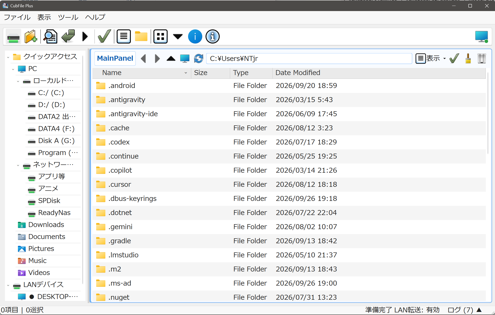

## CubFileの特徴

- 複数パネルでフォルダーやファイルを見比べながら操作
- コピー・移動・削除などの基本ファイル操作
- ファイル検索
- ファイル名の一括変換
- クリップボード履歴
- 転送予約
- LAN経由のファイル転送
- テーマ・付属アイコンセットの切り替え
- 高度なファイル振り分けやLAN差分回収（Plus）
- FreeからPlusへライセンスキーでアップグレード

---

## スクリーンショット

### メインウィンドウ

CubFileの基本画面です。左側のクイックアクセスと複数パネルを使って、よく使う場所へ素早く移動できます。

### 付属アイコンセット

CubFileには複数の付属アイコンセットがあり、見た目を切り替えられます。  
**付属アイコンセットの変更はCubFile Freeでも利用できます。**

| Custom 1 | Custom 2 |
| --- | --- |
| 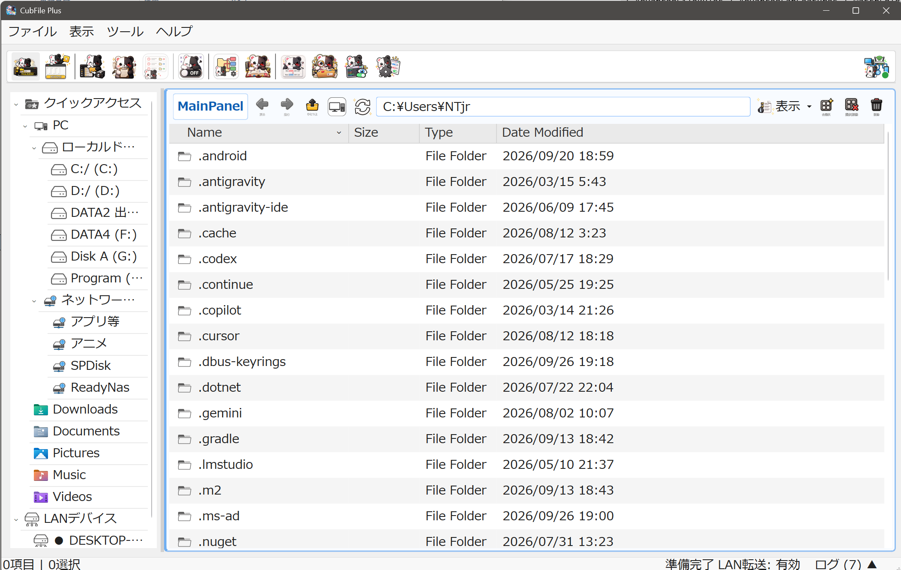 | 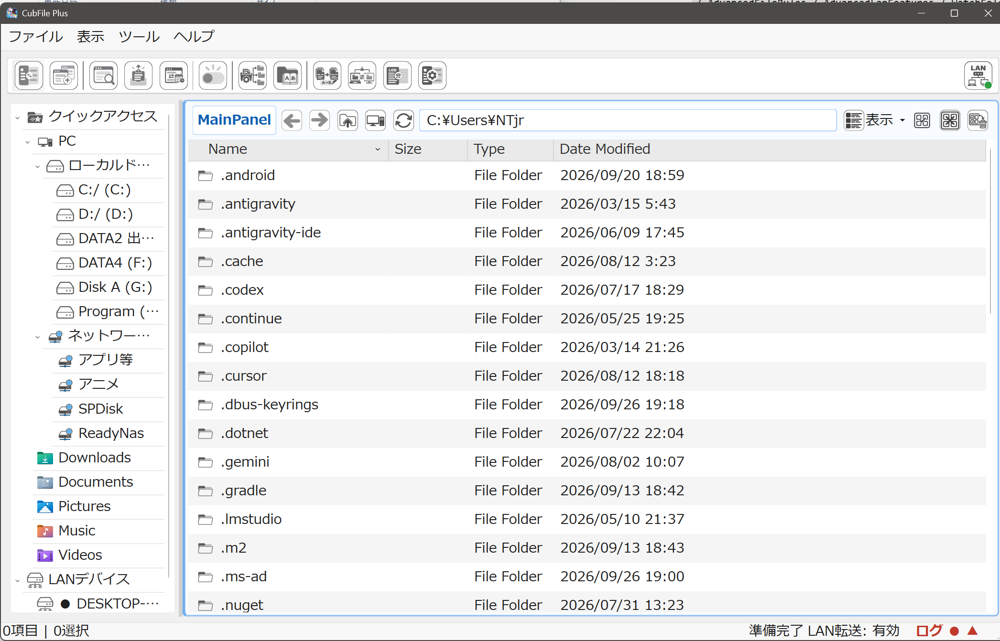 |

---

# 主な機能

## ファイル検索

ファイル名や条件を指定して、目的のファイルを検索できます。

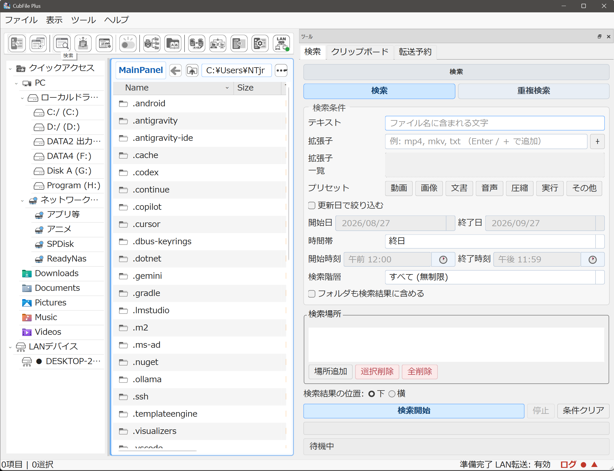

## ファイル名一括変換

複数のファイル名をまとめて変更できます。大量のファイル整理にも利用できます。

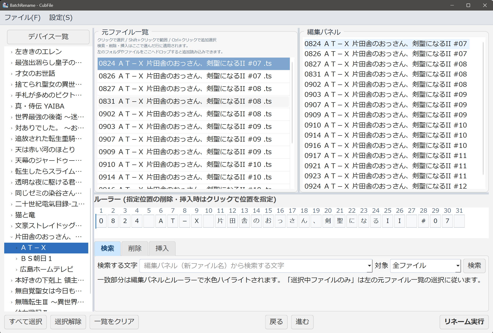

## クリップボード履歴

コピーした項目を履歴から確認できます。過去のコピー内容を参照したいときに便利です。

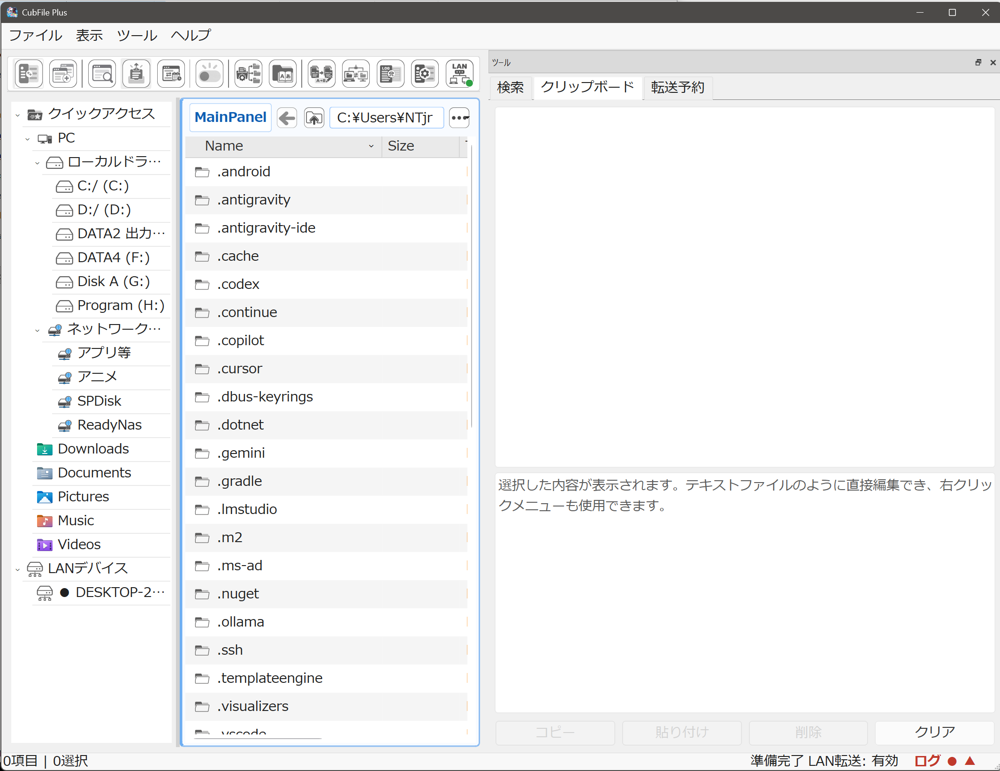

## 転送予約

コピー・移動などの処理を予約し、順番に実行できます。

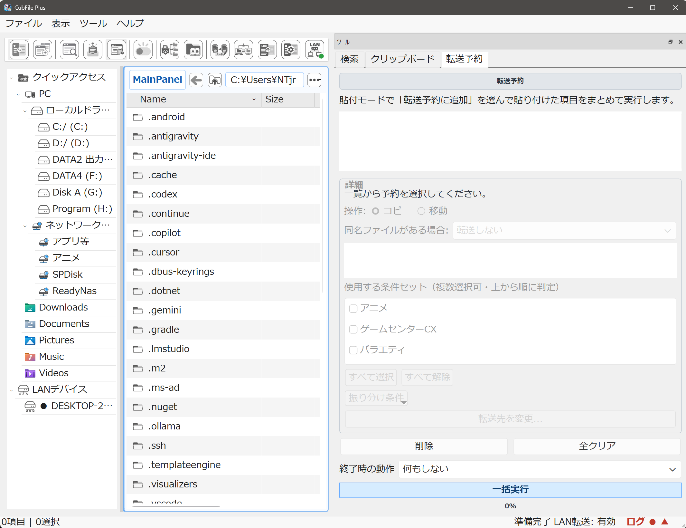

## 設定

表示、パネル、ファイル操作、転送、自動処理、ネットワークなどを設定できます。

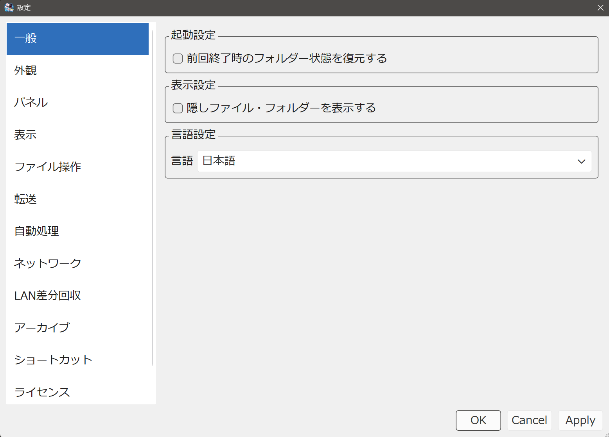

## ログ表示

ファイル操作や各種処理の状態をログから確認できます。

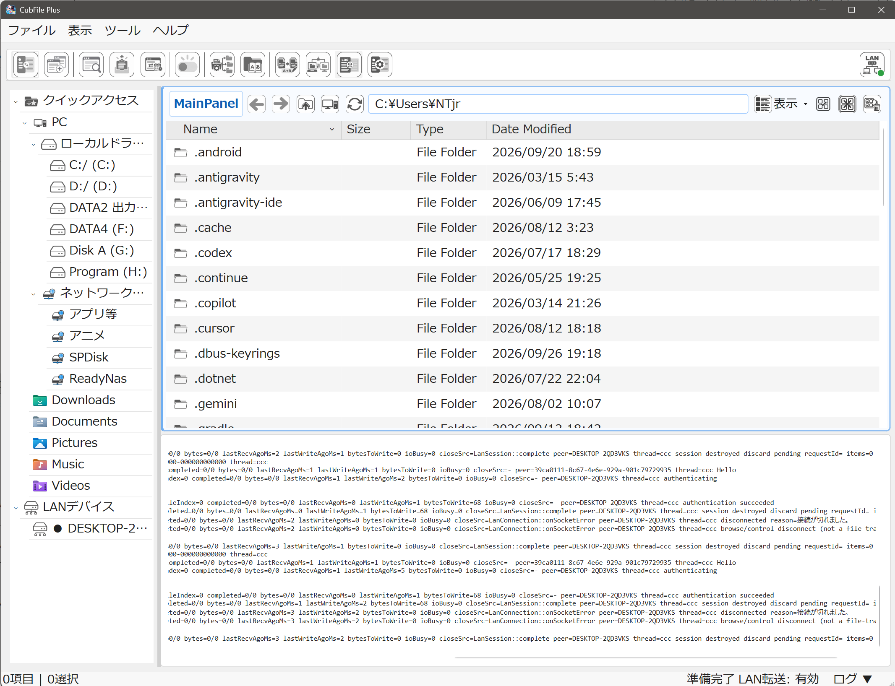

---

# CubFile Plus

CubFile Plusでは、Free版の基本機能に加えて、より高度な整理・自動化・カスタマイズ機能を利用できます。

## 高度な振り分け条件

ファイル名や拡張子などの条件に応じて、ファイルの振り分け方法を細かく設定できます。

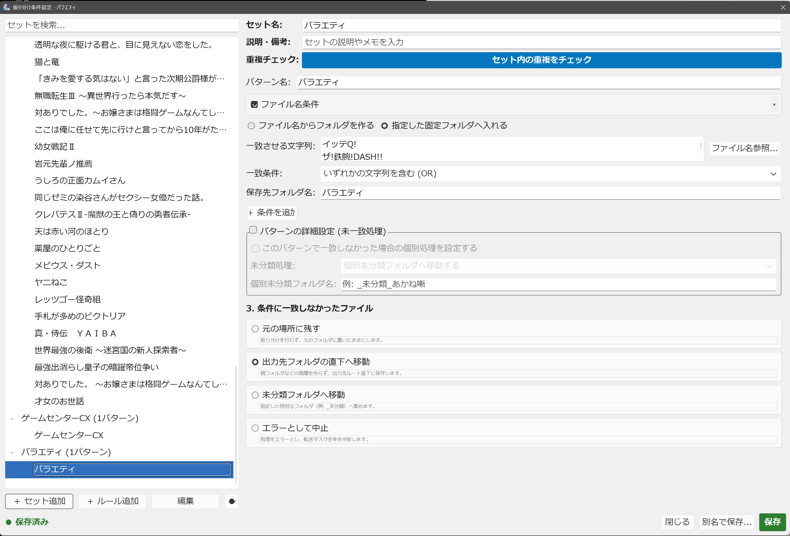

## サブフォルダ辞書

ファイル整理で使用するサブフォルダ名を辞書として管理できます。

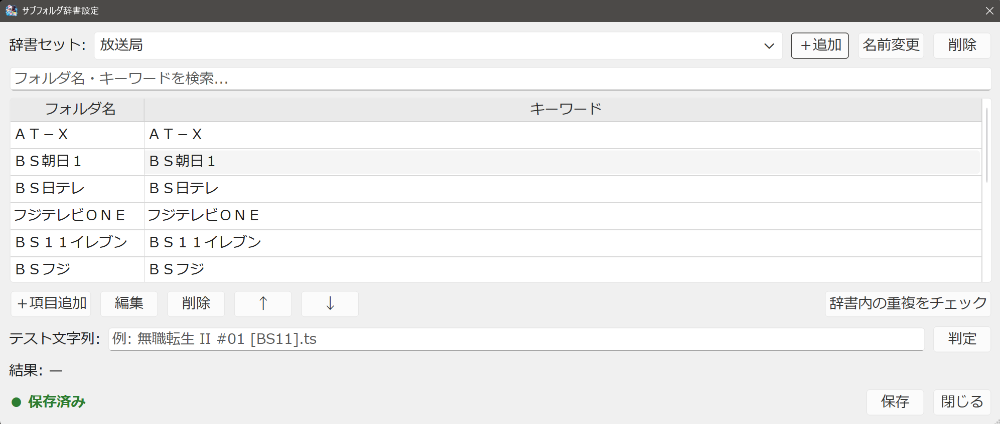

## LAN差分回収

LAN上のPCや共有フォルダーから、条件に応じて差分ファイルを回収できます。

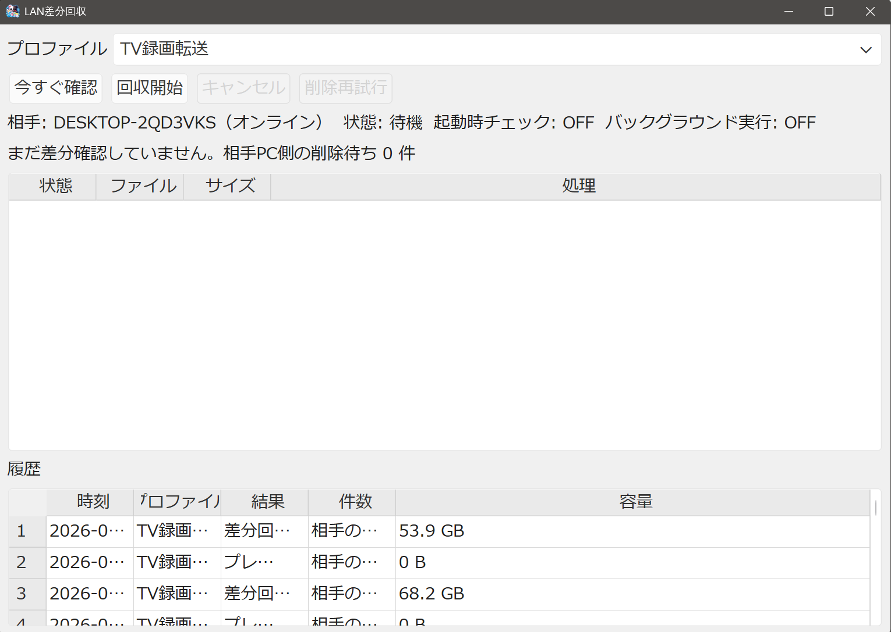

---

# Free / Plus 機能比較

| 機能 | Free | Plus |
| --- | :---: | :---: |
| 基本ファイル操作 | ✓ | ✓ |
| 複数パネル | ✓ | ✓ |
| ファイル検索 | ✓ | ✓ |
| ファイル名一括変換 | ✓ | ✓ |
| 重複ファイル検索 | ✓ | ✓ |
| クリップボード履歴 | ✓ | ✓ |
| 基本LAN転送 | ✓ | ✓ |
| ネットワーク設定 | ✓ | ✓ |
| テーマ変更 | ✓ | ✓ |
| 付属アイコンセット変更 | ✓ | ✓ |
| 高度な振り分け | — | ✓ |
| PowerSort | — | ✓ |
| 高度な進捗設定 | — | ✓ |
| LAN差分回収 | — | ✓ |
| 監視フォルダ | — | ✓ |
| ツールバーのカスタマイズ | — | ✓ |
| ユーザー独自アイコンの追加・管理 | — | ✓ |

> 機能構成は今後のアップデートで変更される場合があります。

---

# ダウンロード

## CubFile Free

CubFile Freeは無料で利用できます。

**Vectorからダウンロード:**  
[CubFile Free をダウンロード](YOUR_VECTOR_URL)

> Vectorで公開後、上の `YOUR_VECTOR_URL` を実際の配布ページURLへ置き換えてください。

---

# CubFile Plusへのアップグレード

CubFile FreeとCubFile Plusは同じアプリです。  
有効なPlusライセンスを登録すると、再インストールせずにPlus機能を利用できます。

1. CubFileを起動
2. **設定** を開く
3. **ライセンス** を選択
4. Vectorから届いたライセンスキーを入力
5. CubFileを再起動
6. タイトルが **CubFile Plus** になればアップグレード完了

ライセンスを登録していない状態では **CubFile Free** として動作します。

---

# 動作環境

| 項目 | 内容 |
| --- | --- |
| OS | Windows 10 / Windows 11 |
| アーキテクチャ | 64-bit |
| ネットワーク | LAN機能を利用する場合は同一ネットワーク環境が必要 |
| その他 | 一部の機能はWindowsの設定やネットワーク環境に依存します |

---

# 更新履歴

最新の変更内容は、このリポジトリの **Releases** をご覧ください。

### Version 1.0.0

- CubFile Free 初回公開
- 基本ファイル操作
- 複数パネル
- ファイル検索
- ファイル名一括変換
- クリップボード履歴
- LAN転送
- Free / Plus ライセンス対応

---

# 不具合報告・機能要望

不具合やご要望は、このリポジトリの **Issues** からお知らせください。

不具合報告では、可能であれば次の情報を添えてください。

- CubFileのバージョン
- Windowsのバージョン
- 発生した操作
- エラーメッセージ
- 再現手順
- 必要に応じてスクリーンショット

> ライセンスキー、メールアドレス、LAN接続情報などの個人情報・機密情報はIssuesへ投稿しないでください。

---

# ライセンスについて

- **CubFile Free** は無料で利用できます。
- **CubFile Plus** の利用には有効なPlusライセンスが必要です。
- 詳しい利用条件・再配布条件については、配布物に含まれる利用規約をご確認ください。

このリポジトリはCubFileの製品情報・スクリーンショット・更新情報を掲載するためのページとして利用できます。  
ソースコードを公開しない場合は、製品本体のライセンスとGitHub上の掲載物を分けて管理してください。

---

## CubFile

**シンプルなファイル操作から、高度なファイル整理・LAN連携まで。**  
Windowsでのファイル管理を、より分かりやすく。
