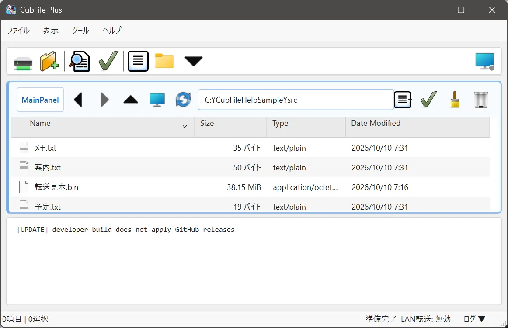

# ログ

## この機能でできること

コピー、転送、振り分け、エラーの記録を画面で読みます。

## 操作前の準備

記録を見たい操作のあとで開きます。

## 操作手順

1. **表示 > ログを表示** を選びます。
2. 下に出た記録を、上から順に読みます。
3. エラーや警告を含む行は、ログボタンの表示でも区別されます。
4. ログの領域を右クリックし、**ログをクリア** で表示を消せます。消しても、すでに終わったファイル操作は元に戻りません。

名前の変更の履歴ファイルは、設定フォルダの `CubFile_リネーム履歴.json` と `CubFile_リネームログ` です。画面のログとは別の記録です。

## 操作中の画面

メインウィンドウのログ領域に、時刻と文章が並びます。

## 完了の確認方法

直前の操作に対応する行があり、エラーの行が残っていなければ、その操作は記録上完了しています。ファイルの実体もフォルダで確認してください。

## 注意事項

ログにパスや相手のアドレスが出ることがあります。画面を人に見せるとき、コピーするときは、その部分を隠してください。

## よくあるトラブル

ログが空のときは、**表示 > ログを表示** がオフか、起動後にまだ操作していない状態です。

## 関連するヘルプページ

- [進捗表示](../network/progress.md)
- [トラブルシューティング](../troubleshooting/index.md)
