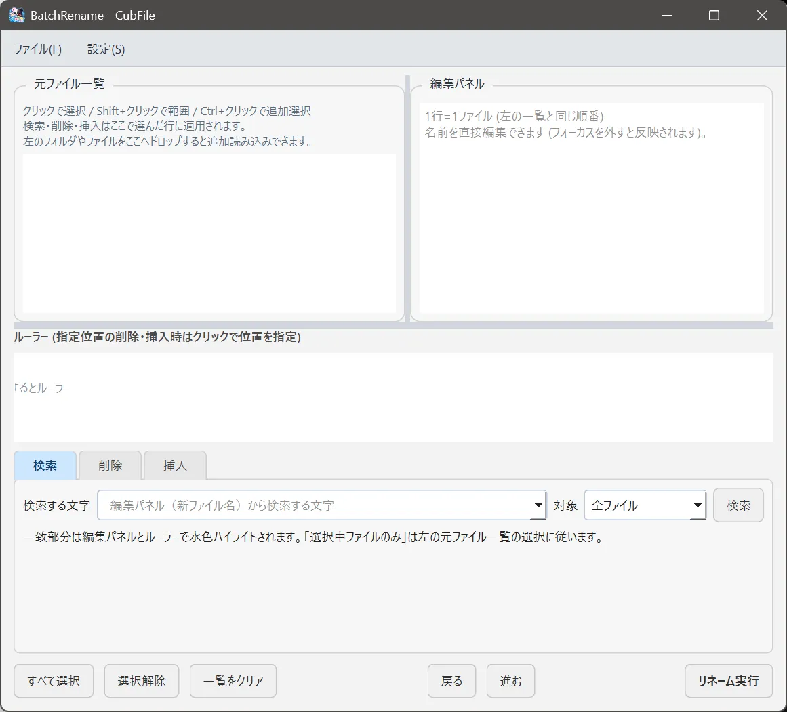

# 一括リネーム

## この機能でできること

選んだ複数のファイルの名前を、まとめて変更する画面を開きます。Free と Plus のどちらでも使えます。

## 操作前の準備

名前を変えるファイルを、同じフォルダで選んでおきます。変更後の名前が重複しない規則にします。

## 操作手順

1. 名前を変えるファイルを選択します。
2. **ツール > 一括リネーム** を選びます。
3. 画面の規則に従って、新しい名前を確認します。
4. 実行する前に、一覧の変更後の名前を読みます。
5. 問題がなければ実行します。

## 操作中の画面

一括リネームのウィンドウが開きます。メインの一覧とは別の画面です。

## 完了の確認方法

元のフォルダに戻り、ファイル名が意図どおり変わっていることを確認します。名前の変更の記録は、設定データの中のリネーム履歴に残ります。

## 注意事項

拡張子をまとめて変えると、ファイルを開けなくなることがあります。実行前の一覧で、末尾まで見てください。

この画面の各入力欄の細かいラベルは、バージョンによって文言が揃うことを優先し、ここでは「規則を確認してから実行する」とだけ説明します。欄の意味が画面と違うと感じた場合は、画面の文言を優先してください。

## よくあるトラブル

メニューが出ないビルドは、一括リネーム機能を外して作られたものです。通常の配布版には含まれます。項目を選んでいないと、対象が空のままです。

## 関連するヘルプページ

- [名前の変更](rename.md)
- [ログ](../advanced/logs.md)
