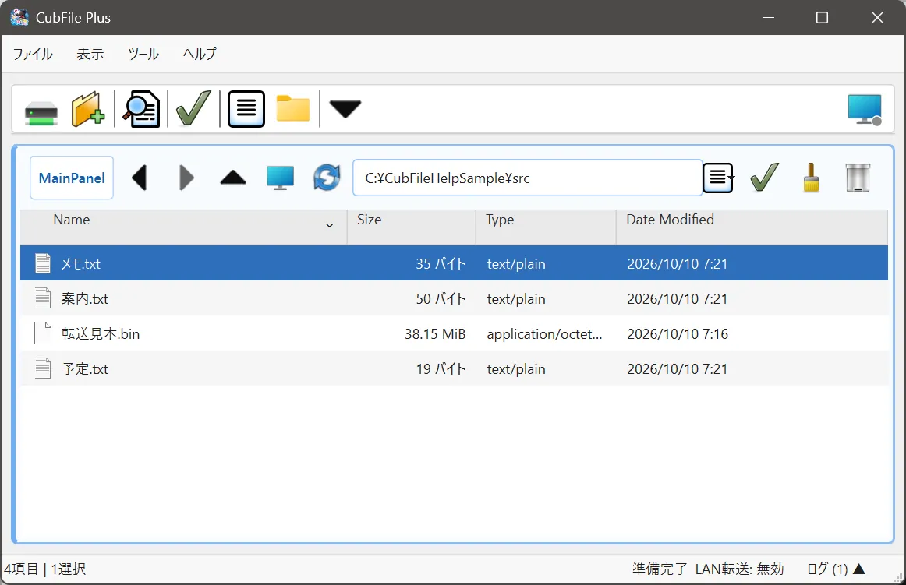
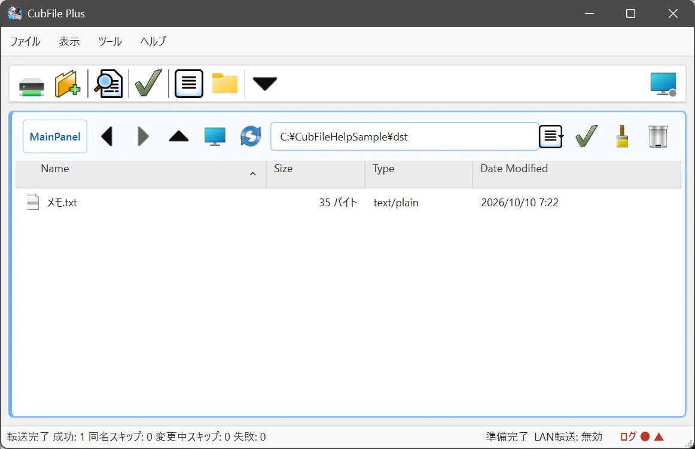

# コピー

## この機能でできること

選んだファイルやフォルダを、別のフォルダへ複製します。同じ PC の中でも、開いているリモートのパネルへも、条件がそろえばコピーを開始できます。

## 操作前の準備

コピー先のフォルダを用意します。貼付モードが「通常貼付」であることを確認します。予約貼付のままでは、その場のコピーにはなりません。

## 操作手順

1. コピー元のパネルで、ファイルまたはフォルダを選びます。
2. 右クリックの **コピー**、または Ctrl+C を選びます。
3. コピー先のフォルダを開きます。
4. コピー先のパネルをクリックして、青い枠を付けます。
5. 右クリックの **貼り付け**、または Ctrl+V を選びます。

## 操作中の画面

件数やサイズが大きいときは、進捗ウィンドウが開くことがあります。自動で開く条件は **設定 > 転送** で変えられます。

## 完了の確認方法

コピー先に同じ名前の項目が増えていること、進捗ウィンドウが完了になっていることを確認します。

## 注意事項

- 同名ファイルの扱いは **設定 > ファイル操作** です。
- Free と Plus のどちらでも、通常のコピーは使えます。
- LAN 上の相手へ送る手順は [LAN転送](../network/transfer.md) です。

## よくあるトラブル

何も増えないときは、コピー先のパネルが選ばれているか、貼付モード、書き込み権限を確認します。

## 関連するヘルプページ

- [移動](move.md)
- [転送予約](../network/reservation.md)
- [進捗表示](../network/progress.md)
