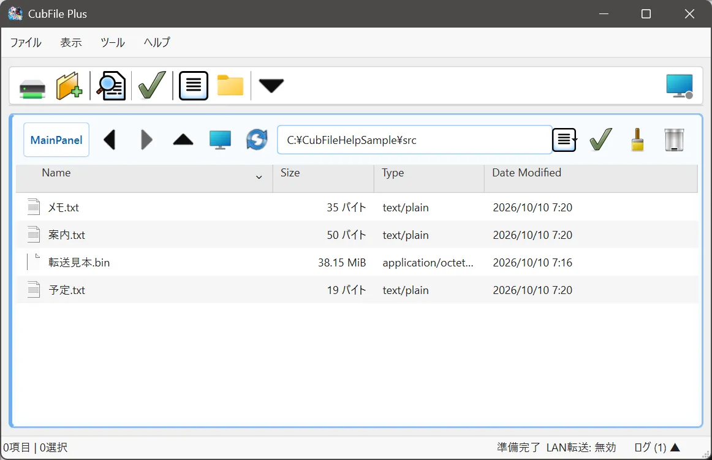

# ツールバーのボタン

## この機能でできること

よく使う操作を、ウィンドウ上部のボタンから実行します。ボタンの表示と非表示も変えられます。

## 操作前の準備

**表示 > ツールバーを表示** にチェックがあることを確認します。

## 操作手順

1. ツールバーのボタンへマウスを乗せ、説明を読みます。
2. **サイドバー** のボタンで、左の一覧を出したり隠したりします。
3. **パネルを追加** で、フォルダを並べます。
4. **貼付モード切替** で、通常貼付と予約貼付を切り替えます。
5. ボタンごとの表示は、**設定 > 表示** のツールバー項目で切り替えます。

## 操作中の画面

チェックを外したボタンは、ツールバーから消えます。ツールバー全体を隠す項目は、個別のボタンとは別にあります。

## 完了の確認方法

必要なボタンだけが残り、クリックして対応する操作が始まることを確認します。

## 注意事項

個別のボタンを選ぶ機能は Plus です。Free では、ツールバー全体の表示は切り替えできます。個別のボタンを変えようとすると、Plus で利用できる旨が表示されます。

開発用のビルドにある Edition の切り替えは、配布版にはありません。

## よくあるトラブル

ボタンが反応しないときは、対象のファイルを選んでいるか、貼付モードが意図と合っているかを確認します。

## 関連するヘルプページ

- [表示設定](../settings/view.md)
- [転送予約](../network/reservation.md)
- [エディションの違い](../licensing/editions.md)
