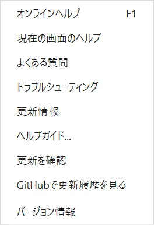
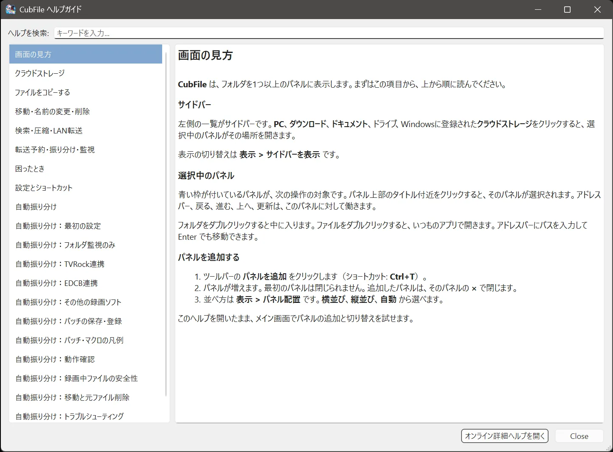

# 画面構成

## この機能でできること

メイン画面のどこを触ると何が起きるかを把握します。

## 操作前の準備

CubFile を起動します。

## 操作手順

画面は、上から次のように並びます。

1. **メニューバー**  
   **ファイル**、**表示**、**ツール**、**ヘルプ** です。
2. **ツールバー**  
   サイドバーの表示、パネルの追加、貼り付けなど、よく使う操作のボタンです。**表示 > ツールバーを表示** で隠せます。
3. **サイドバー**  
   PC、ダウンロード、ドライブなど、移動先の一覧です。**表示 > サイドバーを表示** で隠せます。
4. **ファイルパネル**  
   今開いているフォルダの中身です。青い枠が、操作の対象になるパネルです。
5. **ログ**  
   **表示 > ログを表示** で、操作の記録を出せます。

## 操作中の画面

パネルが2枚あるときは、**表示 > パネル配置** で **自動**、**横並び**、**縦並び** を選べます。ショートカットは Ctrl+Shift+L で配置を順に切り替えます。

## 完了の確認方法

青い枠のパネルと、サイドバーで開いた場所が一致していれば、今どのフォルダを見ているか判断できます。

## 注意事項

- 最初のパネルは閉じられません。追加したパネルは閉じられます。
- 英語表示にしているときは、メニュー名も英語です。意味は日本語メニューと同じです。
- 最小化すると、設定によっては電光掲示板が出ます。詳しくは [表示設定](../settings/view.md) です。

## よくあるトラブル

サイドバーやツールバーが見えないときは、**表示** メニューの該当項目にチェックを入れます。配置が崩れたときは、**表示 > レイアウトをリセット** を使います。

## 関連するヘルプページ

- [基本操作](basic-operations.md)
- [パネル](../file-operations/panels.md)
- [表示形式](../file-operations/view-modes.md)
