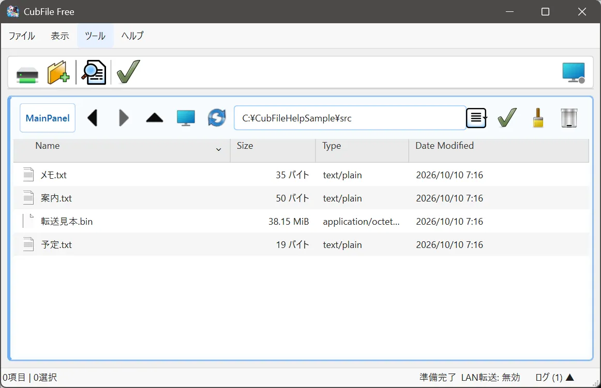
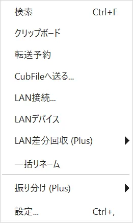

# エディションの違い

## この機能でできること

Free のままで足りるか、Plus が必要かを判断します。機能差はアプリ内部の対応表で決まっています。

## Free と Plus の両方で使える機能

- 付属のアイコンセット
- テーマ
- 複数パネル
- ファイルのコピー、移動、削除、名前の変更
- 進捗ウィンドウ
- 検索
- 重複ファイルの検索
- 一括リネーム
- クリップボード
- 圧縮と展開
- LAN 転送
- ネットワーク設定
- 電光掲示板
- 転送予約
- オンラインヘルプと、アプリ内のヘルプガイド

## Plus で使える機能

Free のメニューでは、名前の後ろに (Plus) と付くか、操作したときに「〜は CubFile Plus で利用できます。」と出ます。

| 画面での名前 | 内容 |
| --- | --- |
| 独自アイコンの追加 | 自分のアイコンを追加する |
| ユーザーアイコンセットの管理 | 独自セットのフォルダを管理する |
| カスタムツールバー | ツールバーのボタンを個別に選ぶ |
| 詳細な進捗設定 | 進捗ウィンドウの詳細な動作 |
| 振り分け | 条件に合わせた振り分けの実行 |
| 詳細なファイルルール | 振り分け条件、サブフォルダ辞書、JSON の読み書き |
| 詳細なLAN機能 | LAN差分回収 |
| 監視フォルダ | 自動振り分け |

## 切り替え方

公開版では、設定のライセンスページで Plus ライセンスを登録し、CubFile を再起動します。開発用ビルドにある Edition の切り替えは、配布版にはありません。

固定の Free ビルドや固定の Plus ビルドは、ライセンスを保存してもエディションは変わりません。その場合は「このビルドはエディションが固定されているため、再起動してもエディションは変わりません。」と出ます。Vector と GitHub で配布している通常の公開版は、ライセンスで切り替わる1種類です。

## 関連するページ

- [ライセンス登録](license.md)
- [振り分け](../advanced/sort.md)
- [アイコン](../settings/icons.md)
