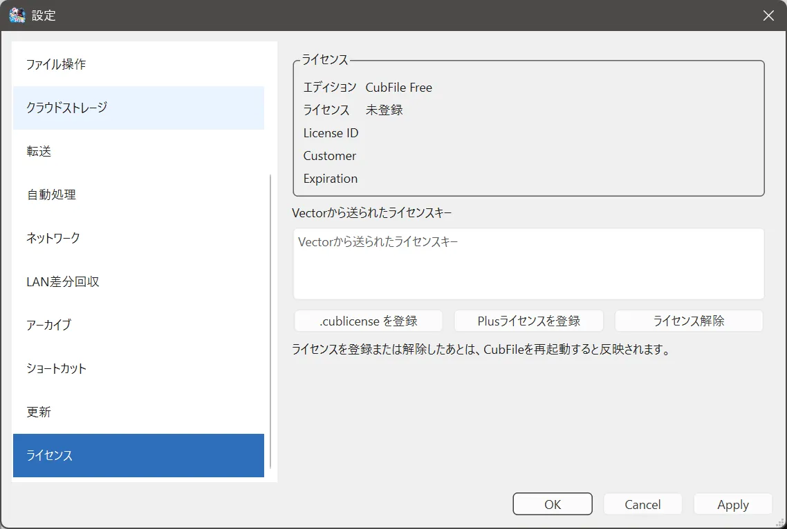

# ライセンス登録

## この機能でできること

Vector から受け取った Plus ライセンスを登録し、再起動後に Plus として使います。

## 操作前の準備

ライセンスキー、または `.cublicense` ファイルを用意します。キーは他人に見せないでください。このヘルプにもキーの例は載せていません。

## 操作手順

1. **ツール > 設定 > ライセンス** を開きます。
2. 今のエディション、ライセンスの状態、License ID、Customer、Expiration を確認します。
3. キーを貼り付ける場合は、入力欄に Vector から送られたライセンスキーを入れ、**Plusライセンスを登録** を押します。
4. ファイルで登録する場合は、**.cublicense を登録** を押し、ファイルを選びます。
5. 「ライセンスを登録しました。CubFileを再起動するとPlusが有効になります。」と出たら、**今すぐ再起動** を押すか、自分で CubFile を終了して起動し直します。

## 操作中の画面

登録に失敗すると、理由のメッセージが出ます。ファイルを開けないときは「ライセンスを確認できませんでした。」と出ます。

## 完了の確認方法

再起動後、ライセンスページのエディションが Plus になり、振り分けなど (Plus) と付いていたメニューが、案内なしで開くことを確認します。

## 注意事項

- 登録と解除は、再起動するまで動作に反映されません。
- **ライセンス解除** は、「PlusライセンスをこのPCから解除しますか？」と確認してから実行します。解除できないときは「ライセンスを解除できませんでした。」と出ます。
- 固定ビルドでは、保存できてもエディションは変わりません。

## よくあるトラブル

再起動前は Free のままです。キーの途中が欠けている、別の製品のキーである、ファイルが空である、といったときは登録メッセージの文章を確認します。Customer の名前が自分のものと違うファイルは登録しないでください。

## 関連するヘルプページ

- [エディションの違い](editions.md)
- [トラブルシューティング](../troubleshooting/index.md)
