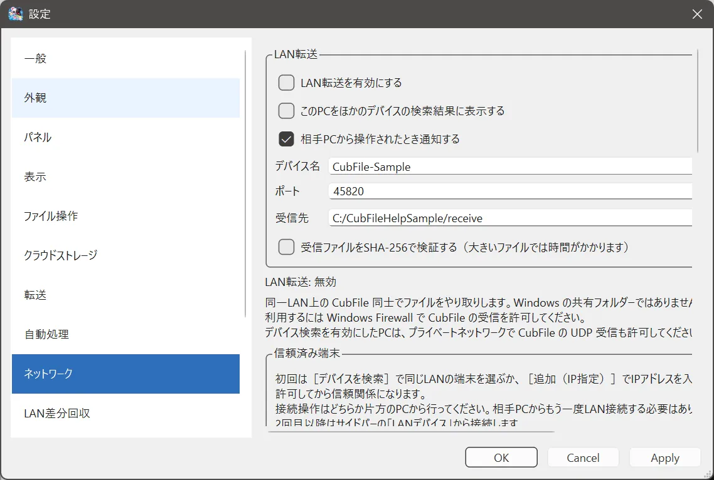

# LAN接続の基本

## この機能でできること

同じ LAN にある2台の PC で CubFile を動かし、ファイルを送ります。インターネット上の不特定の相手へ公開する機能ではありません。

## 操作前の準備

- 両方の PC が同じネットワークに接続されていること。
- 両方で CubFile が起動していること。
- 両方の **設定 > ネットワーク** で「LAN転送を有効にする」にチェックがあること。
- Windows ファイアウォールが、CubFile の通信を遮っていないこと。

## 操作手順

1. 送る側と受け取る側の両方で CubFile を起動します。
2. **設定 > ネットワーク** を開き、LAN転送を有効にします。
3. デバイス名を、自分で区別できる名前にします。公開したくない個人名にする必要はありません。
4. 受け取る側で、共有するフォルダを指定します。
5. 送る側で **ツール > LAN接続** を開き、相手を探します。

## 操作中の画面

ネットワーク設定には、待ち受けの状態が出ます。有効なときは、待ち受けポートの番号が表示されます。初期値は 45820 です。

## 完了の確認方法

相手がデバイス一覧に出て、接続テストが成功すれば、送受信の準備ができています。

## 注意事項

「このPCをほかのデバイスの検索結果に表示する」を外すと、相手の検索結果に自分が出なくなります。ポートを変えたときは、両方を同じ番号にします。

## よくあるトラブル

一覧に出ないときは [接続できないとき](connection-failures.md) を見てください。

## 関連するヘルプページ

- [LANデバイス](devices.md)
- [共有フォルダ](shares.md)
- [ネットワーク設定](../settings/network.md)
