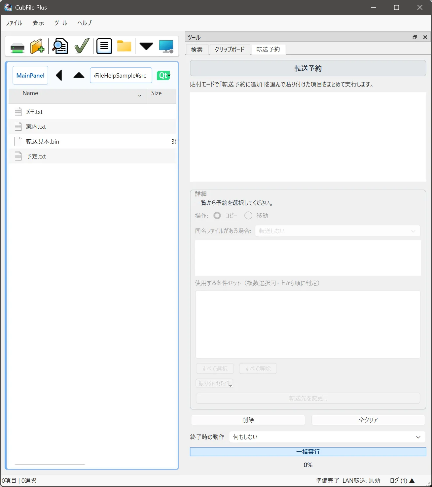

# 転送予約

## この機能でできること

今すぐコピーや送信を始めず、内容を一覧に登録してから実行します。Free と Plus のどちらでも、予約そのものは使えます。予約の行で振り分けを有効にする操作は、振り分け機能の条件に従います。

## 操作前の準備

送りたいファイルと、送り先のフォルダを決めます。

## 操作手順

1. ツールバーの **貼付モード切替** を、予約貼付にします。ボタンの説明が「予約貼付」になっていることを確認します。
2. ファイルをコピーし、送り先で貼り付けます。
3. **ツール > 転送予約** を開き、登録された行を確認します。
4. 行のチェックで、振り分けを付けるかどうかを切り替えられます。振り分けは Plus の条件設定が必要です。
5. 内容を確認してから実行します。
6. 通常の貼り付けに戻すときは、貼付モードを通常貼付にします。

## 操作中の画面

転送予約パネルに、送り先、振り分けの有無、同名のときの扱いが行として出ます。行を選ぶと詳細を見られます。

## 完了の確認方法

実行後、進捗が完了し、送り先にファイルがあることを確認します。

## 注意事項

予約貼付のままでは、Ctrl+V を押してもその場のコピーは始まりません。コピーされないときは、まず貼付モードを見てください。

振り分けのチェックを入れても、条件が未設定のときは「振り分けキーワードルールがありません。」のように止まります。

## よくあるトラブル

一覧が空のときは、予約貼付で貼り付けたかを確認します。実行できない行は、詳細のメッセージを読んで、送り先の有無を直します。

## 関連するヘルプページ

- [コピー](../file-operations/copy.md)
- [振り分け](../advanced/sort.md)
- [進捗表示](progress.md)
