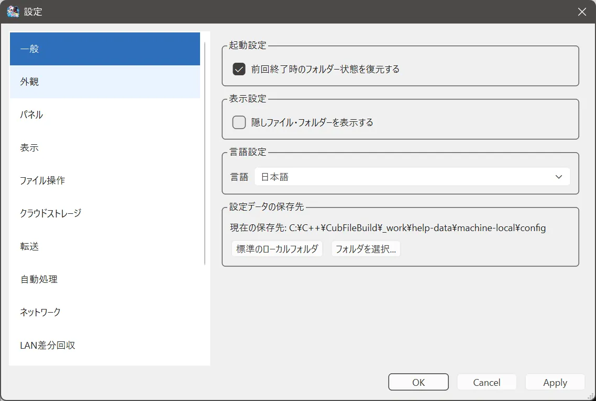

# 一般設定

## できること

起動したときのフォルダ、隠しファイル、言語を決めます。

## 開き方

**ツール > 設定 > 一般**。このページを開いた状態で F1 を押すと、この説明が開きます。

## 項目

- **前回終了時のフォルダー状態を復元する**  
  オンにすると、終了前に開いていたフォルダを次回も開きます。
- **隠しファイル・フォルダーを表示する**  
  オンにすると、Windows で隠されている項目も一覧に出ます。
- **言語**  
  日本語と英語を選べます。メニュー名も一緒に切り替わります。

設定ファイルの場所は、この画面付近と **ファイル** メニューから確認できます。標準はローカルアプリデータです。

## 注意

言語や復元の変更は、適用または OK のあとに反映されます。データ保存先を同期フォルダにすると、設定の上書きを止める案内が出ることがあります。

## 関連するページ

- [初回起動](../getting-started/first-launch.md)
- [重複起動](single-instance.md)
