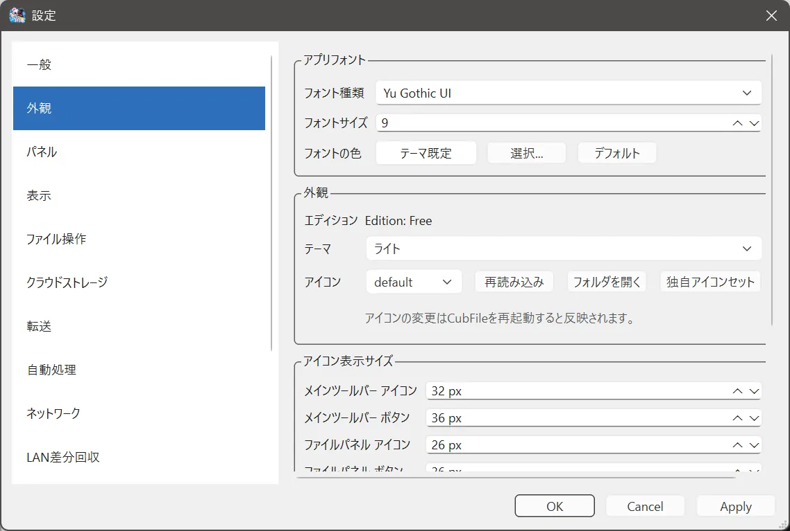

# アイコン

## できること

ファイル一覧のアイコンの絵を、付属のセットから選びます。自分で絵を追加する機能は Plus です。

## 開き方

**ツール > 設定 > 外観** のアイコン欄です。F1 を外観ページで押すと外観の説明が開きます。このページは、アイコンだけを詳しく見るための説明です。

## 項目

- 一覧からアイコンセットを選びます。
- **再読み込み** で、フォルダの追加や削除を一覧へ反映します。使えないセットは一覧から外れます。
- 付属セットのフォルダを開くボタンがあります。
- **独自アイコンセット** は Plus です。ユーザー用のフォルダを開きます。

変更後は「アイコン設定を変更しました。変更内容はCubFileの再起動後に反映されます。」と出ます。

## 注意

再起動するまで、一覧の絵は古いままです。テーマの色とは別の設定です。

## 関連するページ

- [外観](appearance.md)
- [表示形式](../file-operations/view-modes.md)
- [エディションの違い](../licensing/editions.md)
