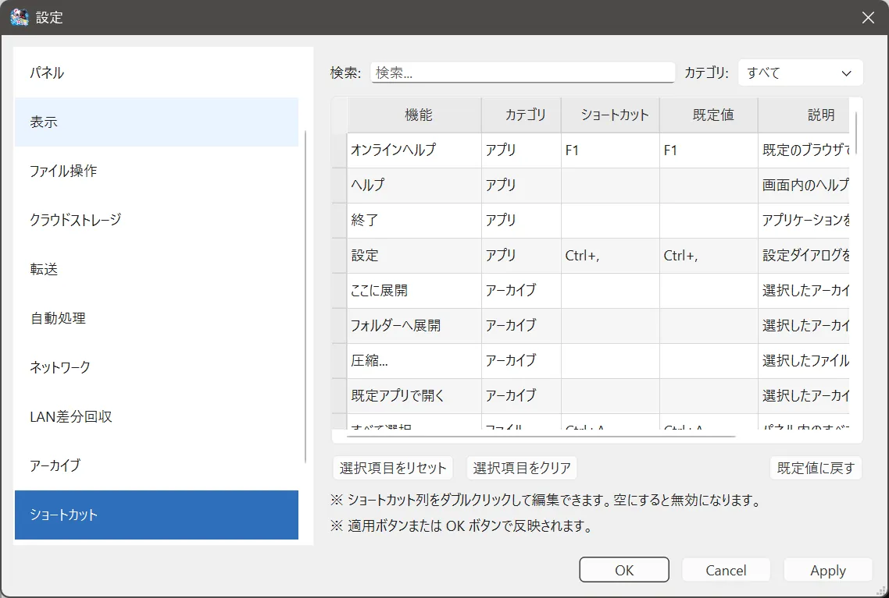

# ショートカット

## できること

メニュー操作に、自分のキーを割り当てます。

## 開き方

**ツール > 設定 > ショートカット**。キーを入力している欄では、F1 はヘルプを開かず、その欄のキーになります。

## 初期状態の主なキー

| 操作 | キー |
| --- | --- |
| オンラインヘルプ | F1 |
| コピー | Ctrl+C |
| 切り取り | Ctrl+X |
| 貼り付け | Ctrl+V |
| 削除 | Delete |
| 名前の変更 | F2 |
| すべて選択 | Ctrl+A |
| 新しいフォルダー | Ctrl+Shift+N |
| 戻る / 進む / 上へ | Alt+← / Alt+→ / Alt+↑ |
| 更新 | F5 |
| パネルを追加 | Ctrl+T |
| 次のパネル / 前のパネル | Ctrl+Tab / Ctrl+Shift+Tab |
| パネル配置を切り替え | Ctrl+Shift+L |
| 検索 | Ctrl+F |
| 設定 | Ctrl+コンマ |

画面内のヘルプガイドは、メニュー **ヘルプ > ヘルプガイド** から開きます。初期状態では F1 はオンラインヘルプです。以前 F1 でヘルプガイドを開いていた環境でも、F1 はオンラインヘルプに移ります。ヘルプガイドに別のキーを割り当てることはできます。

同じキーを複数の操作に割り当てると、適用時に「同じショートカットが複数の操作に設定されています。」と出て、保存できません。

## 注意

文字入力中は、コピーやすべて選択など、一部のキーは文字の編集を優先します。

## 関連するページ

- [画面構成](../getting-started/screen-layout.md)
- [よくある質問](../faq.md)
