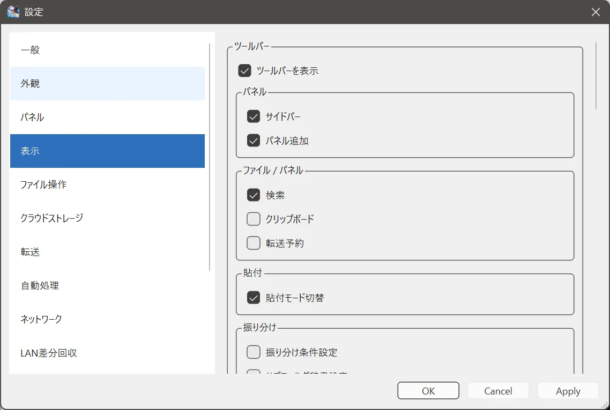

# 表示設定

## できること

ツールバーと、最小化時の電光掲示板を設定します。

## 開き方

**ツール > 設定 > 表示**。

## 項目

- **ツールバーを表示**  
  ウィンドウ上部のボタン全体を出します。Free と Plus のどちらでも切り替えできます。
- **各ボタンのチェック**  
  どのボタンを出すかを選びます。この個別の選択は Plus（カスタムツールバー）です。
- **最小化時に電光掲示板を表示**  
  最小化のとき、転送などの文字を流します。常に手前へ出すか、流れる速さ、見た目を同じページで指定できます。**電光掲示板をテスト表示** で確認できます。Free と Plus のどちらでも使えます。

電光掲示板はドラッグで移動でき、端をドラッグするとサイズを変えられます。クリックすると CubFile へ戻ります。

## 注意

個別ボタンのチェックを Free で変えると、Plus の案内が出ます。ツールバー全体の表示切替は引き続き使えます。

## 関連するページ

- [ツールバーのボタン](../file-operations/custom-buttons.md)
- [外観](appearance.md)
