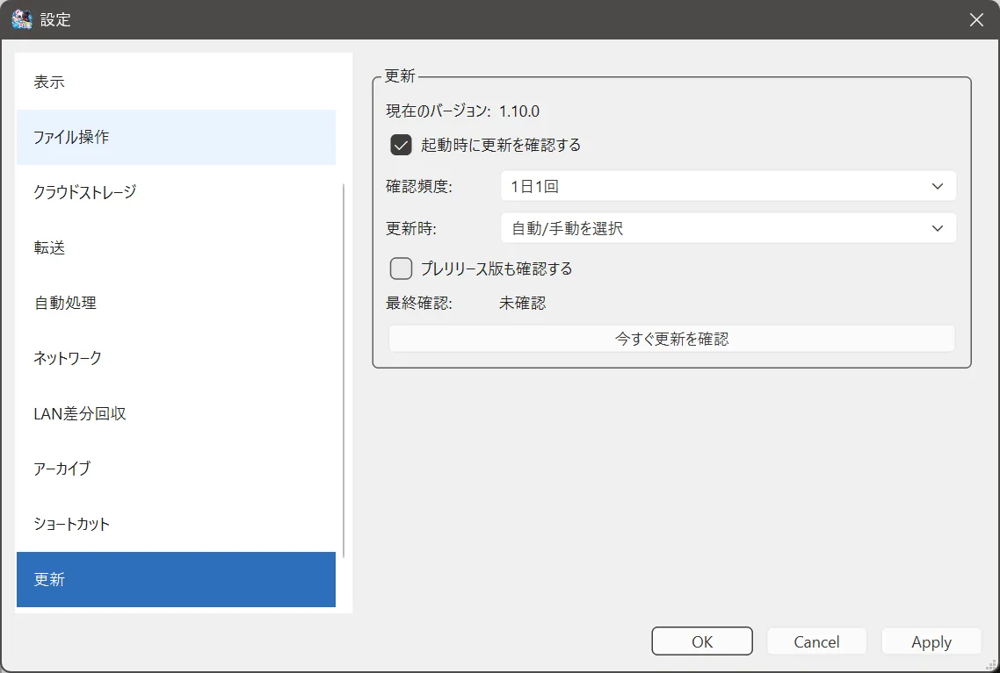

# 更新確認

## この機能でできること

GitHub Releases に新しい CubFile があるかを確認します。

## 操作前の準備

インターネットに接続します。プロキシやファイアウォールが GitHub を遮っていないことを確認します。

## 操作手順

1. **ヘルプ > 更新を確認** を選びます。
2. または **設定 > 更新** の **今すぐ更新を確認** を押します。
3. 新しいバージョンがあるときは、自動更新、手動更新、後での選択が出ます。
4. 同じバージョンなら、その旨の結果を確認します。

設定の **更新** には、今のバージョン、起動時に確認するか、確認頻度（毎回、1日1回、7日ごと）、更新時の動作（自動/手動を選択、自動更新を優先、通知のみ）、プレリリース版も確認するか、最終確認の時刻が並びます。

## 操作中の画面

確認中は「確認中です」と出ます。自動更新を無効にして作られたビルドでは、「このビルドでは自動更新が無効です。更新の通知と手動更新を利用できます。」と出ます。通常の公開版は自動更新を含みます。

## 完了の確認方法

最終確認の表示が更新され、新しいバージョンの有無が分かります。

## 注意事項

**ヘルプ > GitHubで更新履歴を見る** は、ブラウザで Releases のページを開きます。ヘルプの「更新情報」は、この説明ページを開きます。

Source code の zip は更新用のプログラムではありません。

## よくあるトラブル

確認できないときは、ブラウザで [Releases](https://github.com/Hibagonn/CubFile/releases) が開けるかを試します。開けるのにアプリだけ失敗するときは、セキュリティソフトが CubFile の通信を止めている可能性があります。

## 関連するヘルプページ

- [自動更新](auto.md)
- [手動更新](manual.md)
